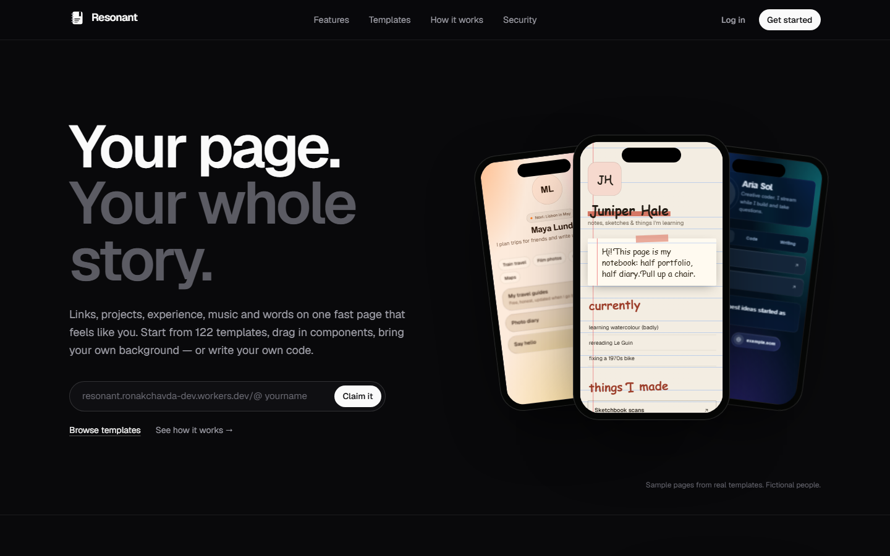
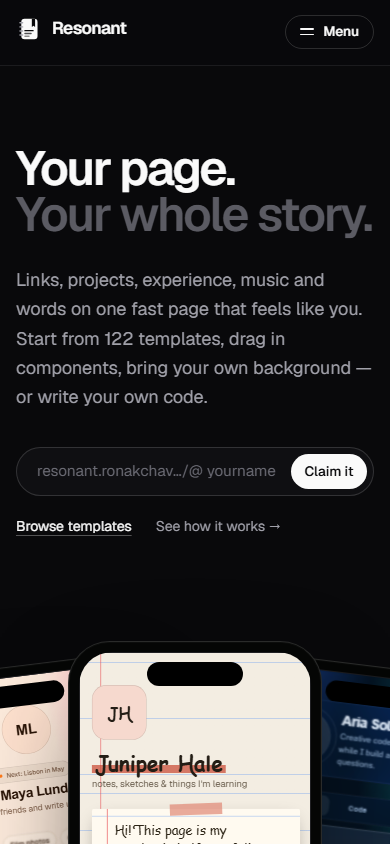
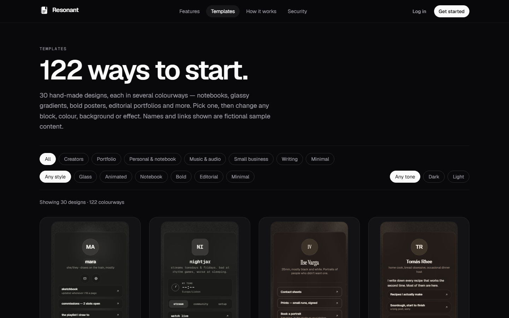
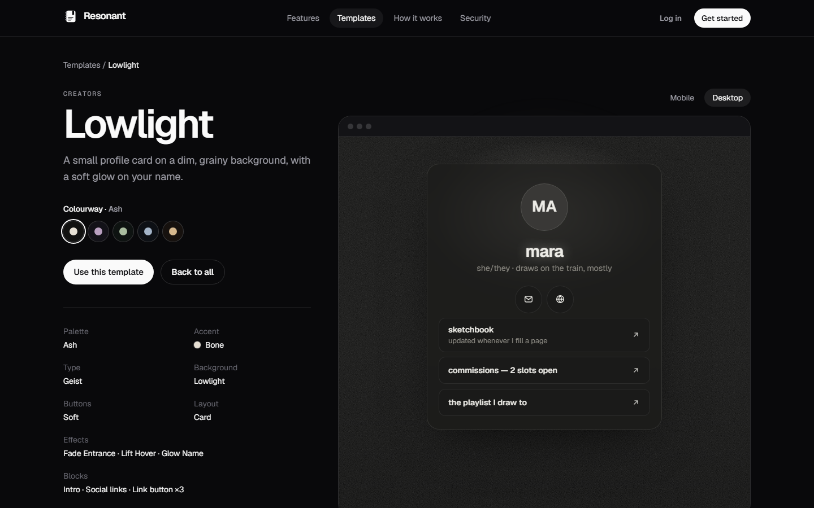

# Resonant

**Your page. Your whole story.**

One link for everything you make: a personal page, link-in-bio and one-page portfolio in one place.

[**Visit Resonant →**](https://resonant.ronakchavda-dev.workers.dev)

 

 

## What is Resonant?

Most people end up with their work scattered everywhere: a portfolio here, a shop there, a podcast, a playlist, a few social profiles. Resonant puts it all on one page that actually feels like you, at a short address you can drop into any bio: `/@yourname`.

You start from a template, change whatever you like, and publish. There's no code to write and no layout to fight with, and the result looks good on a phone as well as a laptop.

## Who it's for

- **Creators and artists** who want one link that shows everything they make
- **Designers and developers** who need a quick, polished one-page portfolio
- **Musicians and podcasters** sharing releases, episodes and where to listen
- **Small shops and makers** pointing people to products, orders and FAQs
- **Anyone** who wants a personal corner of the internet without building a website

## What you can do

- **Start from a template.** 30 hand-made designs in 120+ colourways: notebooks, glassy gradients, bold posters, editorial portfolios, résumés and more.
- **Build by dragging.** Add links, text, images, galleries, videos, music, FAQs, timelines and more from a library of ready-made pieces, then drag them into place. Every edit can be undone.
- **Make it yours.** Change colours, fonts, buttons, backgrounds and effects without touching your content.
- **Add more pages.** Turn your page into a small site with tabs or stacked sections, and add a background song if you like.
- **Go further with custom code.** Write your own HTML, CSS and JavaScript in a built-in code studio when the blocks aren't enough.
- **Let people talk back.** Turn on comments for your page, and hide or remove any of them.
- **See what's working.** Simple daily counts of views and link clicks.

 

<table>
  <tr>
    <td width="68%"></td>
    <td width="32%"></td>
  </tr>
  <tr>
    <td align="center">The editor: pick a block, edit it, see it live</td>
    <td align="center">Made for phones first</td>
  </tr>
</table>

<table>
  <tr>
    <td width="50%"></td>
    <td width="50%"></td>
  </tr>
  <tr>
    <td align="center">Browse templates by category, style and tone</td>
    <td align="center">Try every colourway before you start</td>
  </tr>
</table>

All names and links in the screenshots are fictional sample content.

## Private by default

Resonant is built to collect as little as possible. Visitors who aren't signed in get no cookies, and view counts are kept without IP addresses or device identifiers. Your drafts stay private until you publish, and you can take your page offline whenever you want. The [privacy](https://resonant.ronakchavda-dev.workers.dev/privacy) and [security](https://resonant.ronakchavda-dev.workers.dev/security) pages explain it all in plain language.

## License

Resonant is open source under the [MIT License](LICENSE).

 
Made by Ronak Chavda

