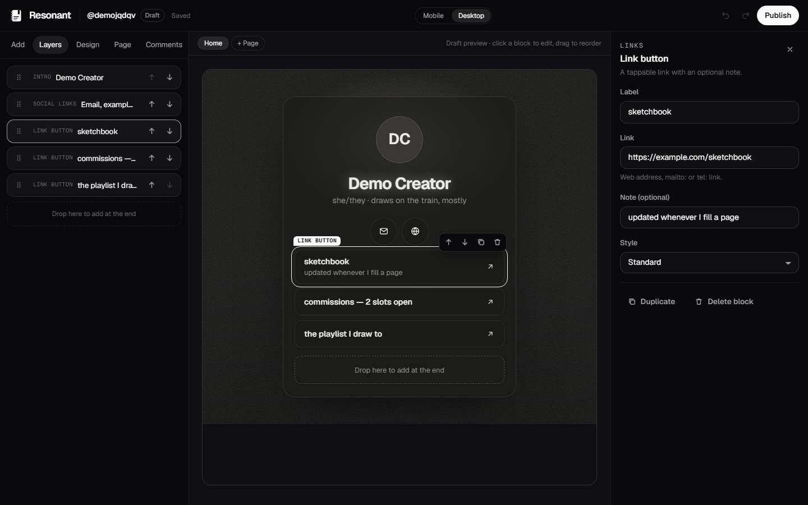

<div align="center">

# Resonant

**Your page. Your whole story.**

A link-in-bio and one-page portfolio builder. Pick a design, drag in blocks, publish at `/@yourname`.

[**Live site →**](https://resonant.ronakchavda-dev.workers.dev)

<br />


</div>

<br />

## What it does

Resonant gives creators a fast, good-looking personal page without fighting a website builder. Each page is made of structured blocks (intro, links, gallery, video, music, FAQ, custom code and more), styled by curated themes. That keeps pages quick to load, easy to read and safe to render.

- **Drag-and-drop editor.** Live canvas, a searchable component library, layers, undo/redo, autosave, and mobile/desktop previews. Every drag action also has keyboard controls.
- **Hand-made templates.** 30 base designs in 120+ colourways (notebooks, glassy gradients, bold posters, editorial portfolios), all filterable by category, style and tone.
- **Real customisation, with guard rails.** Palettes, accents, fonts, button styles, backgrounds and card effects come from design tokens, so there's no fragile user CSS.
- **Multi-page sites and music.** Add pages as tabs or stacked cards, and a background track that only plays after a visitor clicks in.
- **Custom code, sandboxed.** Write HTML, CSS and JS in a built-in code studio. It runs in an isolated iframe with a strict CSP.
- **Comments.** Optional per page, signed-in visitors only, with owner moderation.
- **Analytics without tracking.** Simple daily view and click counters per page, deleted along with the page.

<br />

<table>
  <tr>
    <td width="68%"></td>
    <td width="32%"></td>
  </tr>
  <tr>
    <td align="center"><sub>The editor: layers, live canvas, inspector</sub></td>
    <td align="center"><sub>Built for narrow screens first</sub></td>
  </tr>
</table>

<table>
  <tr>
    <td width="50%"></td>
    <td width="50%"></td>
  </tr>
  <tr>
    <td align="center"><sub>Browse and filter templates</sub></td>
    <td align="center"><sub>Preview each colourway before you start</sub></td>
  </tr>
</table>

<sub>All names and links in the screenshots are fictional sample content.</sub>

## Built with

| | |
|---|---|
| **App** | React Router v8 (framework mode), TypeScript, Tailwind CSS v4 |
| **Runtime** | Cloudflare Workers via `@cloudflare/vite-plugin` |
| **Data** | PostgreSQL through Cloudflare Hyperdrive (`postgres.js`, plain SQL migrations, no ORM) |
| **Storage** | Cloudflare R2 for uploads (size limits + file-signature checks) |
| **Validation** | Zod v4 schemas shared by editor and server |
| **Editor** | `@dnd-kit`, CodeMirror (loaded on demand) |

## Security, briefly

No app is attack-proof, so here's what Resonant actually does:

- Server-side sessions in `HttpOnly` cookies, with idle and absolute expiry and rotation on sign-in
- Two CSRF layers: an Origin / `Sec-Fetch-Site` check plus per-session tokens
- A strict per-request CSP nonce and the usual security headers
- Ownership checks on every write, and parameterised SQL everywhere
- Rate limits on sign-in, sign-up, publishing and comments
- Google sign-in via OIDC + PKCE, and Argon2id password hashing

The full write-up is on the site's [`/security`](https://resonant.ronakchavda-dev.workers.dev/security) and [`/privacy`](https://resonant.ronakchavda-dev.workers.dev/privacy) pages.

## Running it locally

You'll need Node.js 22+.

```sh
npm install
cp .dev.vars.example .dev.vars   # then set APP_SECRET to 32+ random bytes

npm run db:local                 # embedded Postgres; keep this terminal open
npm run db:migrate               # in a second terminal
npm run dev                      # http://localhost:5173
```

Useful scripts:

```sh
npm run typecheck   # wrangler types + route typegen + tsc
npm test            # vitest unit tests
npm run build && npx vite preview --port 4173   # production build in workerd
```

## Deploying

Deploys go through `npm run deploy:preview` or `npm run deploy:production`. These scripts build with the right `CLOUDFLARE_ENV`, because the Cloudflare Vite plugin bakes the environment in at build time. If you use Cloudflare Workers Builds (deploy on push), set `CLOUDFLARE_ENV=production` as a build variable.

## Project layout

```
app/
  routes/          marketing pages, auth, workspace (dashboard, editor, settings), public profiles
  components/      ProfileView (the one renderer for every page), editor panels, UI
  lib/             block schemas, themes, backdrops, templates, URL safety
  server/          the only code that touches the database, R2, secrets or crypto
workers/app.ts     Worker entry: CSRF origin check, CSP, security headers
migrations/        plain SQL, applied in order
```

<div align="center">
<br />
<sub>Made by Ronak Chavda</sub>
</div>
